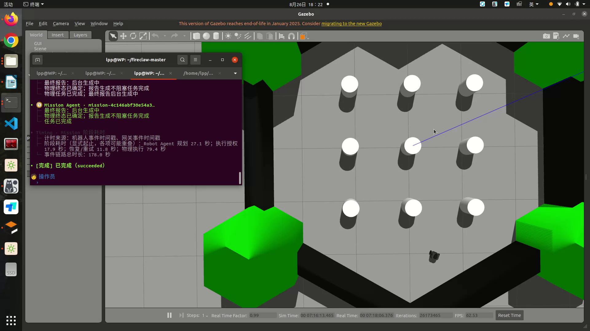
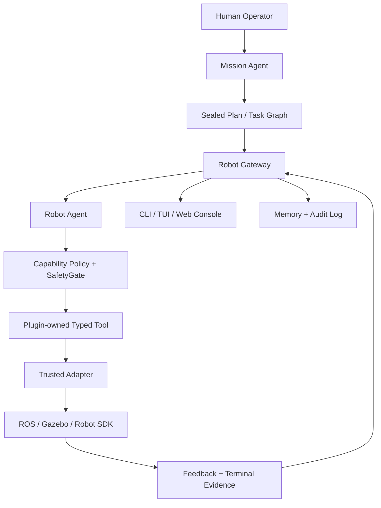

<div align="center">

# 🔥 FireClaw

**面向消防机器人的安全型具身智能 Agent 框架**

用自然语言下达任务，由 Agent 完成规划、工具调用、安全确认、机器人执行与全链路审计。

[](pyproject.toml)
[](docs/deployment/ros1-deployment-guide.md)
[](#安全边界)

[快速开始](#快速开始) · [系统架构](#系统架构) · [演示](#演示) · [文档](#文档导航)

</div>

> [!WARNING]
> FireClaw 当前是研究原型，不是经过认证的消防控制系统。任何真实机器人、传感器、急停链路和物理 Tool 都必须经过具体平台与现场验收。

## 演示

<div align="center">

[](docs/assets/fireclaw-gazebo-patrol-demo.webm)

**点击图片观看完整录屏（3 分 42 秒，WebM）**

</div>

演示展示了一个完整的具身任务闭环：操作员用中文提出四点巡检任务，Mission Agent 生成封存计划，经操作员确认后，Robot Agent 依次调用 `navigate_to_point`，TurtleBot3 在 Gazebo 中完成三个目标点并返回起点，最后输出带阶段耗时的任务终态。

## FireClaw 能做什么

| 能力 | 当前实现 |
|---|---|
| 自然语言任务 | 将操作员指令转换为结构化 Mission 与 Robot Task |
| 任务规划 | 支持有序/条件任务图、澄清、封存计划与失败策略 |
| Plugin / Skill / Tool | Plugin 管理生命周期，Skill 描述工作流，Tool 提供原子 typed operation |
| 物理安全 | 执行前安全门控、显式确认、授权绑定、超时、取消与 fail-closed |
| 机器人接入 | ROS1、Gazebo、Simulator 与 SDK 通过 Adapter 隔离 |
| 执行监控 | Gateway 事件流、任务状态、重试/恢复、操作员状态投影 |
| 记忆与审计 | 记录任务、观察、计划、工具调用、结果与证据链 |
| 本地控制台 | CLI/TUI 与 Rescue Ops Web Console |

当前主要验收范围是**单机器人、单楼层、二维 `map` 坐标导航**。跨楼层定位、电梯/楼梯、多机器人实机协作与认证级安全控制仍不在当前能力声明内。

## 系统架构



核心设计原则：

- `MissionAgent` 理解任务、选择机器人并生成任务图，但不直接调用 ROS。
- `FireClawGateway` 管理会话、队列、插件、授权和事件流。
- `FireClawAgent` 负责本机推理、安全门控和执行监控。
- Plugin 拥有领域 Tool、Adapter 与 Runtime 绑定；core 不按具体 Tool 名称分派。
- `RobotAdapter` 只承担可信状态与平台边界，机器人副作用不能藏在 planner 中。
- 所有物理动作都应产生足以复盘的授权、调用、反馈和终态证据。

术语与边界详见 [Plugin / Skill / Tool / Runtime 术语规范](docs/architecture/plugin-skill-tool-terminology.md)。

## 快速开始

### 1. 安装开发环境

需要 Python 3.10 或更新版本：

```bash
git clone https://github.com/honeyfrostshcolar/fireclaw.git
cd fireclaw

python3 -m venv .venv
.venv/bin/python -m pip install --upgrade pip
.venv/bin/python -m pip install -e ".[dev]"
```

确认 CLI 可用：

```bash
.venv/bin/fireclaw --help
```

### 2. 无机器人快速验证

运行内置的单机器人 dry-run demo：

```bash
.venv/bin/python -m fireclaw_core.devtools.demo
```

运行本机诊断：

```bash
.venv/bin/python -m fireclaw_core.devtools.doctor \
  --adapter mock-ros1 \
  --robot-id doctor-demo \
  --memory-path /tmp/fireclaw-doctor-memory.jsonl \
  --event-path /tmp/fireclaw-doctor-events.jsonl
```

### 3. 启动 Gazebo 仿真

首次使用可由 CLI 完成 setup、受管服务启动与 Web Console 打开：

```bash
.venv/bin/fireclaw setup
```

后续运维命令：

```bash
.venv/bin/fireclaw start
.venv/bin/fireclaw status
.venv/bin/fireclaw open
.venv/bin/fireclaw stop
```

`stop` 只证明 FireClaw 托管进程已退出；没有 Adapter/硬件停止证据时，不得把它解释为机器人已经物理静止。完整流程见 [首次运行指南](docs/getting-started/first-run-setup.md)。

## 当前导航插件

[`extensions/navigation-move-base`](extensions/navigation-move-base) 提供 Navigation Skill、ROS1 `move_base` Adapter 与以下 typed Tools：

- `navigate_to_point`
- `move_base_navigation_status`
- `move_base_get_parameters`
- `move_base_set_parameters`
- `move_base_cancel_navigation`
- `move_base_clear_costmaps`

ROS1 diagnostics 由独立的 [`extensions/ros1-diagnostics`](extensions/ros1-diagnostics) Plugin 提供。物理导航只能由已加载 Plugin 注册的 handler 执行；未知 Tool 默认拒绝。

## 仿真与实机隔离

仿真和实机配置不能共用：

| 模式 | 配置 | 行为 |
|---|---|---|
| Simulation | 从 `fireclaw.sim.example.toml` 或 setup 生成本地 `fireclaw.sim.toml` | 允许连接受控 Gazebo/仿真 Runtime |
| Real robot | 从 `fireclaw.real.example.toml` 建立私有 `fireclaw.real.toml` | 默认非致动，必须人工审查、预检和显式授权 |

本地 Profile、凭据、运行日志、Robot memory 与现场数据均已被 `.gitignore` 排除。不要提交真实场地地图、机器人凭据、私有网络地址或含人员信息的日志。

完整规则见 [仿真/实机配置隔离](docs/deployment/simulation-real-config-separation.zh-CN.md) 与 [实机安全验收](docs/deployment/real-robot-hardware-safety-acceptance.md)。

## 测试与发布验证

```bash
# 全量测试
.venv/bin/python -m pytest -q

# Python 语法/导入检查
.venv/bin/python -m compileall -q src tests extensions

# 构建 wheel
.venv/bin/python -m pip wheel . --no-deps --no-build-isolation --wheel-dir /tmp/fireclaw-wheel
```

发布由两个独立产物组成：轻量 Core Wheel 与包含 ROS/Gazebo 源码及配置的 Simulation Bundle。完整门禁见 [Distribution Contract](docs/release/distribution-contract.md)。

## 仓库结构

```text
src/fireclaw_core/          Agent、Gateway、planner、policy、memory、mission
extensions/                 Plugin、Adapter、ROS workspace 与插件测试
robots/                     机器人平台与仿真 companion 源码
skills/                     Agent-facing SKILL.md 工作流
examples/                   Profile 与 Adapter 示例
tests/                      单元、集成、安全和浏览器端到端测试
tools/release/              Wheel / Simulation Bundle 发布门禁
docs/                       架构、部署、评测与安全文档
```

`openclaw/` 和 `emem-main/` 仅用于本地架构研究，不是 FireClaw 运行依赖，也不会提交到仓库。

## 文档导航

- [首次运行与 setup](docs/getting-started/first-run-setup.md)
- [架构与 OpenClaw 对齐](docs/architecture/fireclaw-openclaw-alignment.zh-CN.md)
- [Plugin SDK](docs/architecture/plugin-sdk.zh-CN.md)
- [导航 Tool 调用链](docs/architecture/navigation-tool-flow.zh-CN.md)
- [ROS1 部署](docs/deployment/ros1-deployment-guide.md)
- [Gazebo 调试](docs/deployment/ros1-gazebo-debugging-guide.md)
- [具身评测协议](docs/evaluation/embodied-evaluation.md)
- [安全审计](docs/architecture/security-audit.md)

## 安全边界

- 自然语言命令本身不是执行危险或不可逆动作的充分授权。
- 状态缺失、过期、冲突或通信中断时，系统应停止、保持、请求澄清或升级给操作员。
- `accepted`、`cancel_requested`、进程退出都不等于机器人已经物理停止。
- Simulation Profile 不能静默驱动真实硬件。
- FireClaw 目前不宣称满足任何消防、工业机器人或功能安全认证标准。

## 致谢与许可证

FireClaw 的 Agent、Session、Plugin、Skill、Tool、Gateway 与本地持久化边界参考了 [OpenClaw](https://github.com/openclaw/openclaw)，并针对消防机器人加入物理安全、状态不确定性、执行证据与 ROS Runtime 隔离。

仓库中的第三方 ROS/TurtleBot3 源码保留各自许可证与 provenance。当前 FireClaw 自研代码尚未声明项目级开源许可证；在正式发布或允许第三方复用前，应由项目所有者选择并补充 `LICENSE`。
